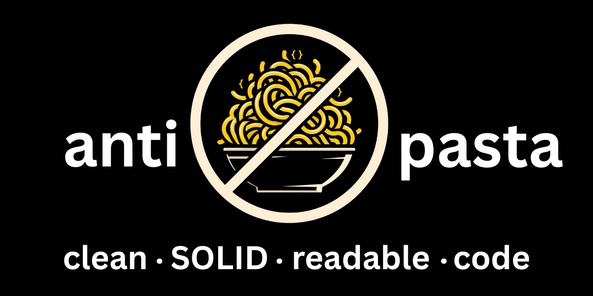

# antipasta

A code quality static analysis library that helps you maintain code that is well-architected according to SOLID principles, readable and well-factored.

## What is antipasta?

antipasta analyzes source code and presents a terminal overview of complexity, maintainability, and structural metrics. Run `antipasta report .` with no configuration to get started. Add `--fail-on` to enforce configured thresholds in CI: violations then produce exit status 2.

antipasta has full Python analysis and lightweight JavaScript/TypeScript support in the metrics and report pipeline through lizard for cyclomatic complexity and line-count metrics.

## Installation

### From PyPI (Recommended)

```bash
pip install antipasta
```

### Development Installation

```bash
# Clone the repository
git clone https://github.com/hesreallyhim/antipasta.git
cd antipasta

# Install with development dependencies (automatically creates venv)
make install-dev
```

### Requirements

-   Python 3.11 or higher

## Quick Start

```bash
# Analyze the current directory with built-in defaults
antipasta report .

# Enforce thresholds when a gate is wanted
antipasta report src/ --fail-on
```

### Generate Configuration

Configuration is optional. To customize the defaults, generate a user configuration:

```bash
# Interactive mode - writes your user configuration
antipasta config generate

# Non-interactive mode - writes shipped defaults
antipasta config generate --non-interactive

# Start from a preset
antipasta config generate --preset readable --non-interactive

# Keep configuration in this repository instead
antipasta config generate --project --non-interactive

# Generate to a custom location
antipasta config generate --output my-config.yaml
```

The interactive mode will guide you through setting up:
- Complexity thresholds (cyclomatic, cognitive, maintainability)
- Advanced Halstead metrics (optional)
- Python language setup; JavaScript/TypeScript can be configured manually for cyclomatic complexity and line counts
- Ignore patterns (enter one at a time, with default test patterns optional)
- Gitignore integration settings

Presets provide smaller starting points for common tradeoffs such as readability, compactness, architecture, and test-suite maintainability. See [`docs/presets.md`](docs/presets.md) for the preset list and merge rules.

Some metric families are experimental: opinionated, off by default, and enabled only by an `experimental` config block or the `--experimental` flag. See [`docs/experimental_metrics.md`](docs/experimental_metrics.md).

The interactive mode validates all inputs and shows valid ranges:
- **Cyclomatic Complexity**: 1-50 (recommended: 10)
- **Cognitive Complexity**: 1-100 (recommended: 15)
- **Maintainability Index**: 0-100 (recommended: 50)
- **Halstead Volume**: 1-100000 (recommended: 1000)
- **Halstead Difficulty**: 0.1-100 (recommended: 10)
- **Halstead Effort**: 1-1000000 (recommended: 10000)

If you enter an invalid value, you'll be prompted to try again with helpful error messages.

#### Interactive Configuration Example

When running `antipasta config generate`, you'll see prompts like:

```
Welcome to antipasta configuration generator!
==================================================

Let's set up your code quality thresholds:
----------------------------------------
  ℹ️  Range: 1-50 (lower is stricter). Recommended: 10
Maximum cyclomatic complexity per function [10]:

File patterns to ignore during analysis:
----------------------------------------
Include default test file patterns? (**/test_*.py, **/*_test.py, **/tests/**) [Y/n]: y
  ✓ Added default test patterns

Enter additional patterns to ignore (one per line, press Enter with no input to finish):
Pattern (or press Enter to continue): *.pyc
  ✓ Added: *.pyc
Pattern (or press Enter to continue):
  Total patterns to ignore: 4
```

## Available Commands

antipasta provides the following commands:

| Command | Description | Default behavior |
|---------|-------------|------------------|
| `report [PATH]` | Analyze a file or directory; optionally enforce thresholds | Print a terminal table; exit 0 regardless of violations unless `--fail-on` is set |
| `config generate` | Generate a configuration interactively or with defaults | Write the user configuration; `--project` writes `.antipasta.yaml` in cwd |
| `config validate [PATH]` | Validate configuration files | Validate available user and project layers and the effective configuration |
| `config view` | Print effective merged configuration | YAML; `--sources` explains which layer supplied each key |
| `config path` | Show configuration, cache, and snapshot locations | Resolve paths for the current directory |
| `vcs` | Mine git history for churn, coupling, hotspots, and suite-health ratios | Use the current repository; hotspot join requires a snapshot |
| `test-health` | Analyze coverage contexts for test redundancy and blast radius | Read coverage.py data recorded with `--cov-context=test` |

Running `antipasta` without a command displays help. The hidden, deprecated `metrics` and `stats` commands retain their existing options and behavior, including default gating for `metrics` and CSV/multiple-format exports for `stats`. Each emits a deprecation notice on stderr.

## Basic Usage

### Analyze Files

```bash
# Analyze all supported files in a directory
antipasta report src/

# Analyze one file, or select multiple files explicitly
antipasta report src/main.py
antipasta report --files src/main.py --files src/utils.py

# Use a custom configuration and a threshold override
antipasta report . --config my-config.yaml --threshold cyc=15

# Gate a CI run; quiet suppresses progress, while report data is still emitted
antipasta report src/ --fail-on --quiet

# Output the unchanged JSON snapshot format
antipasta report src/ --format json
```

The existing `--directory`/`-d` and repeatable `--files`/`-f` options remain available. A positional PATH cannot be combined with those selectors. Missing optional configuration layers use inherited defaults; an explicitly selected missing configuration is an error.

### Visual Report

```bash
# Generate a self-contained offline HTML report (treemap, per-function tables)
antipasta report src/ --format html --output report.html --open

# Emit the raw JSON snapshot instead, plus the 10 worst functions on the terminal
antipasta report src/ --format json --output snapshot.json --top 10

# Trend workflow: snapshot, refactor, then diff — delta-colored tiles, a regressions
# table in the HTML, and a terminal summary of what your change did to complexity
antipasta report src/ --format html --output report.html --save-baseline   # writes report.baseline.json
antipasta report src/ --format html --output report.html --baseline report.baseline.json
```

The HTML report is a single file with no network dependencies (d3 is embedded), so it can be opened from any `file://` URL or attached to a CI run. Tile area is source lines of code; tile color is the selected metric against its configured threshold. Metrics unavailable for a language render neutral.

Terminal tables compare their displayed aggregates with the previous cached run for the same repository and compatible analysis scope. Each analysis root has its own previous-run slot, so alternating subdirectories preserves their histories. A first run has no delta column. `--baseline PATH` pins an explicit JSON snapshot instead. The cache is disposable: deleting it removes the previous-run comparison until another snapshot is stored. Use `--save-baseline` or `--format json --output PATH` for history you want to keep.

### Validate Configuration

```bash
# Validate the available user and project configuration layers
antipasta config validate

# Validate a specific configuration file
antipasta config validate my-config.yaml
```

### View Configuration

```bash
# Print the effective merged YAML configuration
antipasta config view

# Show source attribution on stderr alongside effective configuration
antipasta config view --sources

# Inspect configuration for a different analysis directory
antipasta config view --directory src/

# View effective configuration as JSON or a table
antipasta config view --format json
antipasta config view --format table

# View a file verbatim, without merging
antipasta config view --path custom-config.yaml --format raw

# Show resolved configuration, cache, and snapshot paths
antipasta config path
```

### Group Statistics

```bash
# Group terminal statistics by directory or Python package
antipasta report src/ --by directory
antipasta report src/ --by module

# Write the grouped table to a file
antipasta report src/ --by module --output modules.txt
```

`--by` applies only to `--format table` (the default). Combining it with HTML or JSON is a usage error. These grouped views reuse the existing statistics aggregation. An explicit `--baseline` adds a separate baseline diff summary; aggregate delta columns belong to the ungrouped overview. JSON output remains the analysis snapshot.

### Version-Control Mining

```bash
# Mine the last 90 days of git history
antipasta vcs

# Join hotspots to a previously generated report snapshot
mkdir -p .cache
antipasta report src/antipasta --format json --output .cache/antipasta-snapshot.json
antipasta vcs --snapshot .cache/antipasta-snapshot.json

# Use a different history window or emit JSON
antipasta vcs --window 30 --format json
```

### Test-Suite Health

```bash
# First collect coverage contexts
pytest --cov=src/antipasta --cov-context=test

# Then analyze redundant tests and blast radius
antipasta test-health --coverage-file .coverage
antipasta test-health --coverage-file .coverage --format json
```

## Configuration

The `report` and `config` commands resolve YAML configuration from these layers, with later values taking precedence:

1. Built-in defaults.
2. User configuration at `$XDG_CONFIG_HOME/antipasta/config.yaml`, or `~/.config/antipasta/config.yaml` when unset. On Windows it uses `%APPDATA%\antipasta\config.yaml`.
3. Matching entries in the user configuration's `projects:` map, keyed by absolute repository paths. Entries apply to that path and nested analysis roots, with more specific paths winning.
4. `.antipasta.yaml` in the analysis root, falling back to the current directory. `ANTIPASTA_CONFIG` selects a replacement project layer; an explicit `--config` takes precedence over it.
5. Command-line flags and threshold overrides.

Each layer expands its own preset before merging. Scalars and nested blocks merge by key. Lists replace inherited lists; `languages` merges by language name, but each supplied language's `metrics` list replaces its inherited gates. Omitting a metric from that list removes its gate. `config view --sources` attributes replaced lists as a whole, and both `view` and `validate` warn about unknown top-level keys.

If no layer supplies a Python metric list, its inherited gate thresholds follow the merged `defaults` values; the shipped enabled flags stay unchanged. Explicit metric lists and preset gates remain authoritative. A `projects:` map is supported only in the resolved user configuration file; `view` and `validate` warn when it appears in a project file.

For example, a user configuration can keep repository-specific tuning outside version control:

```yaml
projects:
  /absolute/path/to/repository:
    languages:
      - name: python
        metrics:
          - type: cyclomatic_complexity
            threshold: 12
            comparison: "<="
```

Run `antipasta config path` to inspect the locations used on your system.

### Example Configuration

```yaml
# antipasta configuration file
# Generated by: antipasta config generate

# Default thresholds for all languages
defaults:
  max_cyclomatic_complexity: 10.0
  max_cognitive_complexity: 15.0
  min_maintainability_index: 50.0
  # Halstead metrics (advanced)
  max_halstead_volume: 1000.0
  max_halstead_difficulty: 10.0
  max_halstead_effort: 10000.0

# Language-specific configurations
languages:
  - name: python
    extensions:
      - .py
    metrics:
      - type: cyclomatic_complexity
        threshold: 10.0
        comparison: "<="

      - type: cognitive_complexity
        threshold: 15.0
        comparison: "<="

      - type: maintainability_index
        threshold: 50.0
        comparison: ">="

      - type: halstead_volume
        threshold: 1000.0
        comparison: "<="

      - type: halstead_difficulty
        threshold: 10.0
        comparison: "<="

      - type: halstead_effort
        threshold: 10000.0
        comparison: "<="

# Files and patterns to ignore during analysis
ignore_patterns:
  - "**/test_*.py"
  - "**/*_test.py"
  - "**/tests/**"
  - "**/__pycache__/**"

# Whether to use .gitignore file for excluding files
use_gitignore: true

# Strictness profile for profile-aware derived metrics
profile: standard
```

### Configuration Structure

-   **defaults**: Default thresholds used when language-specific configuration is not provided
-   **languages**: Language-specific configurations
    -   **name**: Language identifier (`python`, `javascript`, or `typescript`)
    -   **extensions**: File extensions to associate with this language
    -   **metrics**: List of metrics to check
        -   **type**: The metric type (see Metrics section below)
        -   **threshold**: The threshold value
        -   **comparison**: How to compare the metric value with the threshold
        -   **enabled**: (optional) Whether to check this metric (default: true, can be omitted)
-   **ignore_patterns**: Additional gitignore-style patterns for files to skip (combined with .gitignore if `use_gitignore` is true)
-   **use_gitignore**: Whether to automatically use patterns from `.gitignore` (default: true)
-   **preset**: Optional coarse metric bundle (`balanced`, `readable`, `compact`, `architecture`, or `testing`)
-   **profile**: Strictness profile for profile-aware derived metrics (`standard`, `relaxed`, or `extreme`)
-   **tree_shape**, **import_graph**, **duplication**: Optional blocks that turn project-scoped informational metrics into configured gates
-   **experimental**: Opt-in metric families, such as `experimental: {narrative: {}}`
-   **projects**: User-configuration map of absolute repository paths to partial overrides

### Comparison Operators

-   `<=` - Metric value must be less than or equal to threshold
-   `<` - Metric value must be less than threshold
-   `>=` - Metric value must be greater than or equal to threshold
-   `>` - Metric value must be greater than threshold
-   `==` - Metric value must equal threshold
-   `!=` - Metric value must not equal threshold

## Metrics Explained

### Lines of Code Metrics

-   **LOC**: Total lines of code
-   **SLOC**: Source lines of code (excluding comments and blanks)
-   **LLOC**: Logical lines of code
-   **Comment Lines**: Number of comment lines
-   **Blank Lines**: Number of blank lines

### Cyclomatic Complexity

Measures the number of linearly independent paths through a function. Higher values indicate more complex control flow.

-   **Good**: 1-10 (simple, easy to test)
-   **Moderate**: 11-20 (more complex, harder to test)
-   **High**: 21+ (very complex, consider refactoring)

Example of high complexity:

```python
def process_data(data, mode, validate, transform):
    if validate:
        if not data:
            return None
        if mode == "strict":
            if not isinstance(data, dict):
                raise ValueError("Invalid data")

    if transform:
        if mode == "simple":
            return data.lower()
        elif mode == "complex":
            if validate:
                return data.upper()
            else:
                return data.title()

    return data
```

### Halstead Metrics

Based on the number of operators and operands in code:

-   **Volume**: Program size based on the number of operations
-   **Difficulty**: How hard the code is to understand
-   **Effort**: Mental effort required to understand the code
-   **Time**: Estimated time to implement (in seconds)
-   **Bugs**: Estimated number of bugs (Volume / 3000)

### Maintainability Index

A composite metric (0-100) that considers cyclomatic complexity, lines of code, and Halstead volume. Higher values indicate more maintainable code.

-   **Good**: 50-100 (maintainable)
-   **Moderate**: 20-49 (moderately maintainable)
-   **Low**: 0-19 (difficult to maintain)

### Cognitive Complexity

Measures how difficult code is to understand, focusing on human comprehension rather than execution paths. Unlike cyclomatic complexity, it penalizes nested structures more heavily.

-   **Good**: 1-15 (easy to understand)
-   **Moderate**: 16-30 (requires careful reading)
-   **High**: 31+ (difficult to understand, consider refactoring)

Key differences from cyclomatic complexity:
-   Heavily penalizes nested control structures
-   Considers break/continue statements in loops
-   Better represents actual cognitive load

## Exit Codes

- **0**: Successful reporting, including violations when `--fail-on` is absent; or valid configuration.
- **1**: Invalid configuration, processing errors, or validation failures.
- **2**: Threshold violations with `report --fail-on` (or legacy `metrics`), or invalid command arguments.

For CI, opt into gating explicitly:

```bash
# Use the effective configuration and preserve the gate's exit status
antipasta report src/ --fail-on

# Check configuration before analysis
antipasta config validate && antipasta report src/ --fail-on

# Suppress progress while preserving the table and failure diagnostics
antipasta report src/ --fail-on --quiet
```

## Terminal Output

The default table groups metrics into Lines of code, Complexity, SOLID, Maintainability, Test quality, VCS, and Experimental sections. Empty optional sections are omitted. Metrics missing from the category policy appear under Other. Metrics at different scopes occupy separate lines. Rows show unit counts, threshold breaches, extreme values, and up to three offenders where a worse direction is defined; metrics without a defined worse direction show minimum, median, and maximum values. Compatible prior snapshots add aggregate deltas. The footer reports the violation count and, with `--fail-on`, the gate's exit status.

Report data goes to stdout, or the file selected by `--output`; diagnostics go to stderr. `--quiet` suppresses progress and supplementary summaries while preserving the requested report data. JSON snapshots and HTML documents remain clean when piped.

## Learning Resources

### Code Complexity Reduction Tutorial

If you're new to code complexity metrics or want to learn how to reduce complexity in your code, check out our comprehensive tutorial:

📚 **[Code Complexity Reduction Tutorial](DEMOS/TUTORIAL/README.md)**

This hands-on tutorial walks you through:
- Understanding what makes code complex
- Step-by-step techniques to reduce complexity
- Real examples showing a 90% reduction in cognitive complexity
- When to stop refactoring (perfect metrics vs practical code)

The tutorial includes 5 progressive versions of the same code, demonstrating techniques like:
1. **Early returns** - The simplest and most effective technique
2. **Function extraction** - Breaking down large functions
3. **Data classes** - Reducing parameter lists
4. **Configuration objects** - Eliminating magic numbers
5. **Enterprise patterns** - When and how to use advanced patterns

Perfect for developers who want to write more maintainable code or teams establishing code quality standards.

## Statistics Collection

Use `antipasta report PATH --by directory` to compare folders or `--by module` to compare Python packages. These views expose file and function counts and line-count aggregates from the same analysis run. Use the default ungrouped table for metric categories, separate scopes, threshold breaches, offenders, and prior-run deltas.

The deprecated `stats` command remains available for existing workflows that need its metric selection, CSV export, or multiple-format output options.

### Project Structure

```
antipasta/
├── cli/              # Command-line interface
├── core/             # Models, derivations, mining, and snapshot storage
│   ├── derive/       # Project-scoped structural metrics
│   ├── mining/       # VCS and coverage-matrix analytics
│   ├── model/        # Config, detector, metric, and violation models
│   └── store/        # Cache, snapshot, diff, and treemap helpers
├── report/           # Offline HTML report rendering and assets
├── runners/          # Language-specific analyzers
│   ├── javascript/   # JS/TS analysis via lizard
│   └── python/       # Python analysis via Radon, Complexipy, and the structural runner
└── schemas/          # Packaged JSON schema
```

## Current Limitations

1. **Python has the broadest metric coverage**: JavaScript and TypeScript currently use lizard for cyclomatic complexity and line counts.
2. **Some metrics are scope-specific**: Several metrics are function-level, while newer structural metrics report at class, module, project, or artifact scope.
3. **Cognitive Complexity Requires Complexipy**: The cognitive complexity metric requires the optional `complexipy` package to be installed.

## Future Enhancements

-   Pre-commit hook integration
-   Git hook support
-   GitHub Actions integration
-   VS Code extension

## Contributing

Contributions are welcome! Please:

1. Fork the repository
2. Create a feature branch
3. Add tests for new functionality
4. Ensure all tests pass
5. Submit a pull request

## Release Process

antipasta releases are managed with Release Please and GitHub trusted publishing.

Use conventional commit-style PR titles so Release Please can infer the correct version bump:

- `fix: ...` for patch releases
- `feat: ...` for minor releases
- `feat!: ...` or a `BREAKING CHANGE:` footer for major releases

After changes are merged to `main`, Release Please opens or updates a release PR. Merging that release PR creates the GitHub release and triggers the `Publish to PyPI` workflow.

Useful maintainer command:

```bash
make release-dry-run  # Build and inspect distributions without uploading
```

For TestPyPI or production publishing, use the manual `Publish to PyPI` workflow dispatch in GitHub Actions. See [CONTRIBUTING.md](CONTRIBUTING.md) for contributor setup and release notes.

## License

[Add your license here]

## Acknowledgments

-   [Radon](https://github.com/rubik/radon) for Python code metrics
-   Inspired by various code quality tools like ESLint, Pylint, and SonarQube
